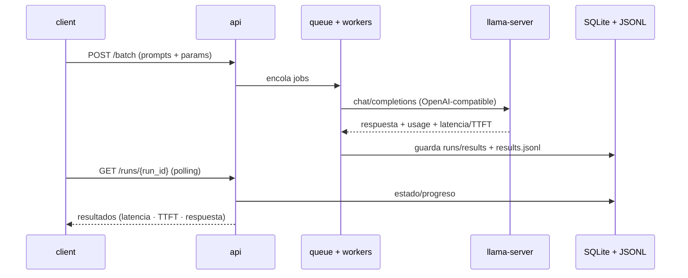

# llm_answer_tester

Banco de pruebas para LLMs locales (**llama.cpp**). Levanta un servidor `llama-server`, una **API FastAPI** que encola prompts contra él y un **cliente batch** que mide latencia, TTFT y persiste todo en SQLite + JSONL.

[](https://docs.docker.com/compose/)
[](https://fastapi.tiangolo.com)

## Contenido

- [Arquitectura](#arquitectura)
- [Servicios](#servicios)
- [Estructura del repositorio](#estructura-del-repositorio)
- [Instalación](#instalación)
- [Uso](#uso)
- [Endpoints](#endpoints)
- [Configuración](#configuración)
- [Roadmap](#roadmap)
- [Licencia](#licencia)

## Arquitectura



## Servicios

| Servicio | Rol                                                                   |
|----------|-----------------------------------------------------------------------|
| `llama`  | `llama.cpp` `llama-server` (endpoint OpenAI-compatible en `:8000`)    |
| `api`    | FastAPI: recibe prompts, los encola y guarda resultados (`:8080`)     |
| `client` | Envía prompts (batch), hace *polling* y reporta latencia/TTFT         |

## Estructura del repositorio

```
llm_answer_tester/
├── docker-compose.yml      # Orquesta llama + api + client
├── prompts/
│   └── prompts.txt         # Un prompt por línea
├── api/
│   ├── app.py              # FastAPI: /ask, /batch, /runs/{id}
│   ├── db.py               # SQLite (aiosqlite): runs + results
│   ├── llm.py              # Cliente chat/completions (streaming opcional)
│   ├── requirements.txt
│   └── Dockerfile
├── client/
│   ├── client.py           # CLI batch + polling
│   ├── requirements.txt
│   └── Dockerfile
└── llama/
    ├── Dockerfile          # Compila llama.cpp (llama-server)
    └── entrypoint.sh
```

## Instalación

```bash
git clone https://github.com/bi0punk/llm_answer_tester.git
cd llm_answer_tester

# 1. Pon tu modelo GGUF en:
cp /ruta/a/tu/modelo.gguf models/model.gguf
#    (o cambia MODEL_PATH en docker-compose.yml)
```

## Uso

```bash
docker compose build
docker compose up -d
```

Health checks:
- Llama: `http://127.0.0.1:8000/health`
- API:   `http://127.0.0.1:8080/health`

Ejecutar un batch con el cliente:

```bash
docker compose run --rm client \
  --server http://api:8080 \
  --prompts /prompts/prompts.txt \
  --stream
```

Resultados:
- SQLite: `data/bench.db`
- JSONL:  `data/results.jsonl`

## Endpoints

| Método | Ruta                 | Descripción                                         |
|--------|----------------------|-----------------------------------------------------|
| GET    | `/health`            | Estado de la API, modelo y configuración            |
| POST   | `/ask`               | 1 prompt, responde de inmediato y guarda            |
| POST   | `/batch`             | Encola N prompts y devuelve `run_id`                |
| GET    | `/runs/{run_id}`     | Estado/progreso de un run                           |
| GET    | `/runs/{run_id}/results` | Resultados (latencia, TTFT, respuestas)         |

## Configuración

Variables de entorno de la API (docker-compose):

| Variable                  | Default                | Descripción                          |
|---------------------------|------------------------|--------------------------------------|
| `DB_PATH`                 | `/data/bench.db`       | Ruta del SQLite                      |
| `RESULTS_JSONL`           | `/data/results.jsonl`  | Ruta del archivo JSONL               |
| `LLM_BASE_URL`            | `http://llama:8000/v1` | URL OpenAI-compatible del LLM        |
| `LLM_MODEL`               | `qwen25`               | Alias del modelo (--alias en llama)  |
| `LLM_TIMEOUT_S`           | `180`                  | Timeout por petición                 |
| `DEFAULT_TEMPERATURE`     | `0.2`                  | Temperatura por defecto              |
| `DEFAULT_MAX_TOKENS`      | `256`                  | Máx. tokens por respuesta            |
| `DEFAULT_STREAM`          | `true`                 | Streaming por defecto                |
| `MAX_QUEUE_SIZE`          | `1000`                 | Límite de la cola (protege RAM)      |
| `WORKERS`                 | `1`                    | Concurrencia (1 = secuencial)        |

Argumentos del cliente: `--server`, `--prompts`, `--temperature`, `--max-tokens`, `--stream`, `--sleep-s`, `--poll-s`.

## Roadmap

- [x] Servidor llama.cpp en Docker
- [x] API con cola asíncrona y workers
- [x] Cliente batch con polling de progreso
- [x] Persistencia SQLite + JSONL con métricas (latencia, TTFT)
- [ ] Dashboard web con comparativa de modelos
- [ ] Métricas agregadas (percentiles, tokens/seg)
- [ ] Comparación cruzada de varios modelos en un solo run

## Licencia

Sin archivo `LICENSE` declarado en el repositorio.